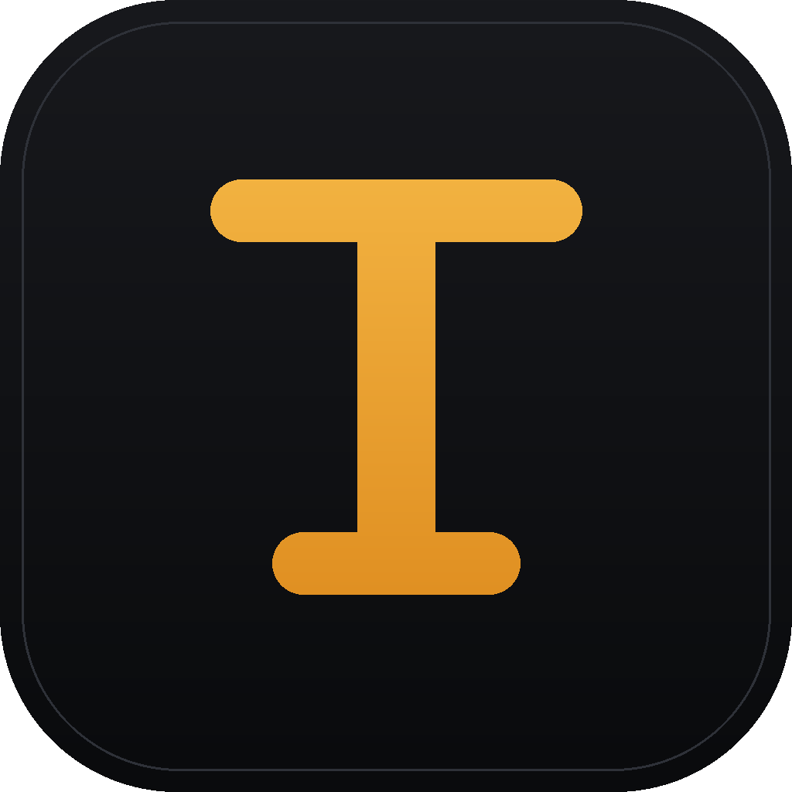

# Toplix Pro

A fast, focused AI coding assistant for macOS, Windows, Linux and Android — inspired by the best parts of Codex, Claude Code and modern chat UIs. One window, your models, zero clutter.



## Features

- **Multi-provider models** — connect OpenAI (ChatGPT & Codex models), Anthropic (Claude), OpenRouter, or any OpenAI-compatible endpoint (Ollama, LM Studio, Groq…)
- **MCP tool servers** — connect Model Context Protocol servers (streamable HTTP) and the model can call their tools mid-conversation, with collapsible tool cards in the chat
- **ChatGPT magic-link sign-in** — sign in from chatgpt.com in your browser; Toplix Pro receives the token automatically via its custom URL scheme
- **Streaming responses** with markdown rendering, syntax-highlighted code blocks and one-click copy
- **Chat history** with a searchable sidebar, stored locally
- **Dark & light themes**, keyboard shortcuts (⌘N new chat, ⌘, settings, Esc stop)
- **Private by design** — API keys and chats live only on your Mac, requests go straight from the app to the provider

## Install

Downloads for every device are on the [Releases](../../releases) page: macOS (`.dmg`), Windows (`.exe`), Linux (`.AppImage` / `.deb`) and Android (`.apk`).

### macOS

The easiest way: download the ready-made DMG from the [Releases](../../releases) page and follow [INSTALL.md](INSTALL.md).

Or build it yourself (requires a Mac with Xcode command-line tools):

```bash
git clone https://github.com/HomekidChud/toplex-pro.git
cd toplex-pro
npm install
npx electron-builder --mac dmg
```

The DMG appears in `dist/`.

## Connect your models

1. Open **Settings → Models & API keys** (⌘,)
2. Paste the API key for a provider:
   - **OpenAI** (ChatGPT / Codex models) — key from [platform.openai.com](https://platform.openai.com)
   - **Anthropic (Claude)** — key from [console.anthropic.com](https://console.anthropic.com)
   - **OpenRouter** — one key for hundreds of models
   - **Custom** — any OpenAI-compatible base URL (Ollama at `http://localhost:11434/v1`, LM Studio, etc.)
3. Pick a model from the picker in the top bar and start chatting.

Without a key the app runs in **demo mode** with simulated responses, so you can explore the UI first.

## Run in development

```bash
npm install
npm start
```

## Building on other platforms

The app is a standard Electron project — `npx electron-builder` on Windows or Linux produces those platforms' installers. DMGs can only be built on macOS (or via the included GitHub Actions workflow, which builds both Apple Silicon and Intel DMGs automatically).

## License

Copyright © 2026 HomekidChud. All rights reserved.

This source code is proprietary. You may not copy, modify, redistribute, or create derivative works from it without the owner's written permission. See [LICENSE](LICENSE) for the full terms.
